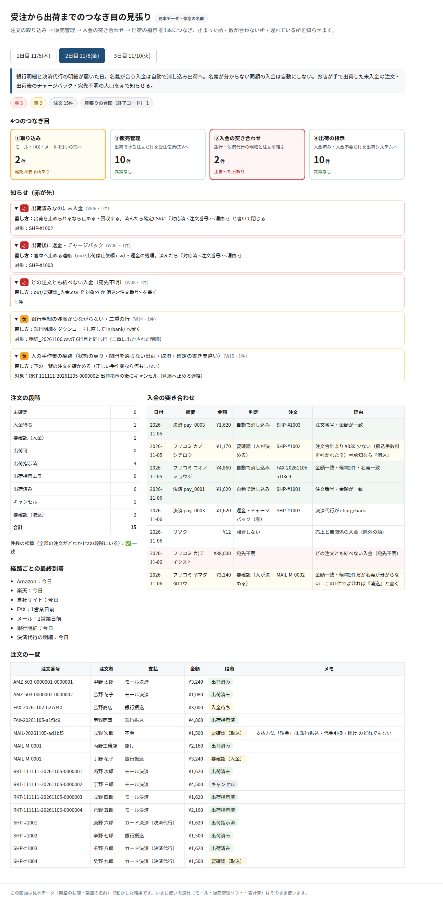

# 受注〜出荷の「つなぎ目」見張り デモ

受注（EC・FAX・メール）→ 販売管理 → 入金確認 → 出荷指示 の間で起きる
「入れ忘れ・二重・未入金のまま出荷」を、毎日自動で突き合わせて知らせる仕組みの画面デモです。

- デモ画面: https://ai-flow-architect.github.io/order-seam-watch-demo/
- 1〜3日目のタブで、赤（すぐ対応）・黄（要確認）の知らせと直し方、入金の照合表を確認できます
- 振込名義が分からない入金・金額が合わない入金は自動で消し込まず、人が一覧で決めます

※ 表示しているデータはすべて架空です。外部のサーバーや鍵には接続していません。

AIフローアーキテクト
